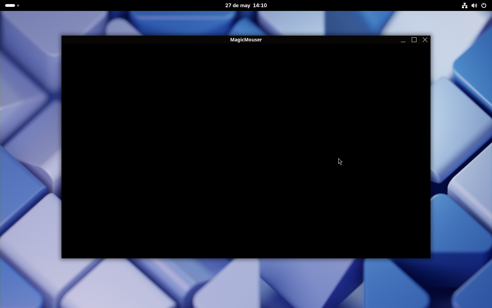
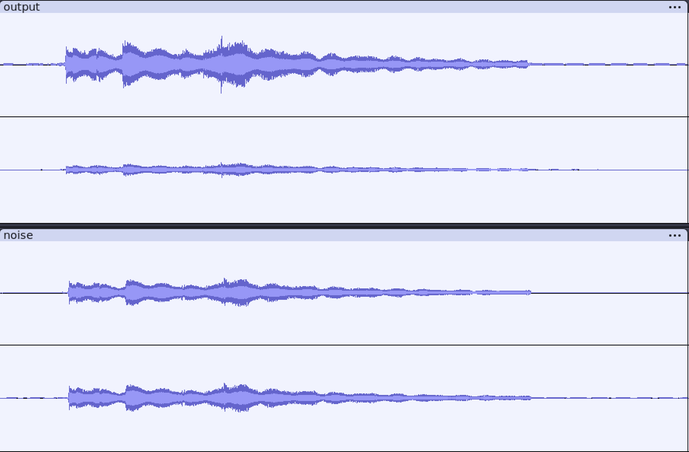

# MagicMouser

**Spatial audio test window with real-time playback based on click position.**



MagicMouser is an interactive spatial audio demo that maps mouse clicks within a 2D window to binaural audio cues using KEMAR impulse responses. It enables intuitive exploration of spatial sound perception through a simple graphical interface, acting as a platform for experimentation, demonstration, and further development in 3D audio rendering.

> 🎓 This project is the culmination of a thesis in Applied Mathematics and Computer Science, aiming to bridge spatial audio rendering and real-time user interaction in a minimalist interface.

---

## 🎧 Features

* 🚀 **Real-time playback** of spatialized audio
* 🖱️ Click-based directionality mapping
* 🌐 +300 unique directions simulated using KEMAR HRTFs
* 📏 Scalable window interface — input maps adaptively to direction
* 📦 Lightweight C implementation using `libsndfile`, `GLFW`, and `PipeWire`/`pw-play`

---

## 🛠️ How it works

1. **Click Mapping**:

   * The 2D window captures click coordinates.
   * These coordinates are mapped to azimuth and elevation:

     * **Azimuth**: from -90° to +90°, sampled every 5°
     * **Elevation**: from -40° to +40°, sampled every 10°

2. **Impulse Selection**:

   * For each position, a corresponding stereo impulse response (IR) is selected from a precomputed dataset derived from KEMAR HRTFs.

3. **Convolution and Playback**:

   * The selected IR is convolved with a mono audio sample.
   * The result is saved as a stereo `.wav` file.
   * Playback is handled via [`pw-play`](https://docs.pipewire.org/page_man_pw-cat_1.html), a PipeWire tool for simple audio output.

---

## 🔧 Requirements

* GCC (with support for sanitizers)
* `libsndfile`
* `GLFW`
* `PipeWire` (with `pw-play` installed)

> ⚠️ Ensure PipeWire is running and your user has audio playback permissions.

---

## 📦 Building

```bash
make -j$(nproc)
```

## ▶️ Running

```bash
make run
```

Then click anywhere inside the window to hear a spatialized version of the sound from that direction.

---

## 🧪 Testing & Debugging

* Uses `-fsanitize=address,undefined` for runtime safety
* Use `make clean` to clear object files and binaries

---

## 🌍 Portability & Future Work

Current implementation is Linux-only via `pw-play`. Planned expansions:

* 🎯 Cross-platform support (CoreAudio/macOS, WASAPI/Windows)
* 🎛️ In-app audio engine (remove `pw-play` dependency)
* 📡 Head-tracking support
* 🧠 Neural HRTF switching
* 🛠️ CLI for batch processing or remote trigger

---

## 📁 Folder structure (suggested)

```
magicmouser/
├── impulses/            # Impulse responses
├── main.c               # Entry point
├── core.c               # Audio processing
├── Makefile             # Build system
├── noise.wav            # Click sound
└── README.md            # This file
```

---

## ✨ Screenshot


<p style="text-align: center;">A waveform comparison between original and convolved audio.</p>

Future will includes:

* A diagram mapping azimuth/elevation to window coordinates

---

## 🔐 Security Considerations

Playback is sandboxed via direct invocation (`posix_spawn`) of `pw-play` from `/usr/bin/`, avoiding unsafe shell evaluations. Future plans include embedding playback to reduce surface exposure.

---

## 📜 License

This project is licensed under the GNU General Public License (GPL) version 3.0 or later. You are free to use, modify, and share this software under the terms of this license.

For more details, please refer to the [LICENSE](LICENSE) file in this repository or visit [GNU GPL v3](https://www.gnu.org/licenses/gpl-3.0.html).

---

## 🧠 Author

Daniel a.k.a. \[iPowerWheels] — Punk engineer exploring audio spatiality and low-level computing. This project is dedicated to all the underground tech nerdZ who want to hear the world around them like never before.

> Z-U in the space
